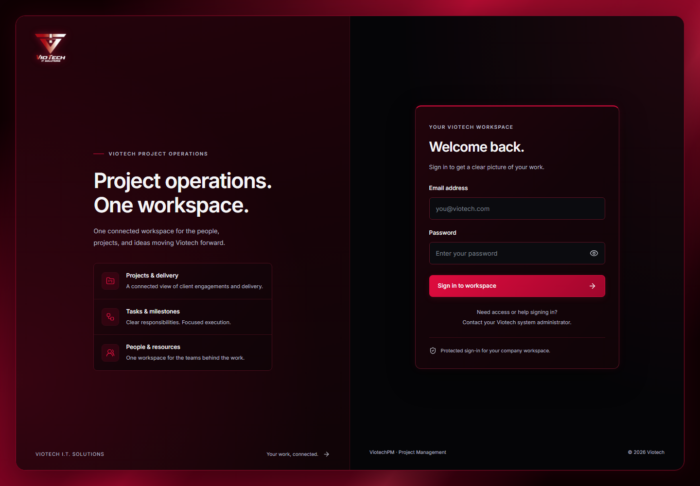

# ViotechPM

## Local administrator login

| Field      | Value                 |
| ---------- | --------------------- |
| Login page | http://localhost:5173 |
| Username   | `admin`               |
| Password   | `admin`               |
| Role       | Super Administrator   |

Use `admin` / `admin` in the login form for this local test workspace. The username is a development-only alias for the existing `admin@viotech.local` account.

These credentials apply only to this configured local test database; do not use this password for production. Other installations use their own `BOOTSTRAP_ADMIN_EMAIL` and `BOOTSTRAP_ADMIN_PASSWORD`. Re-running the seed does not reset an existing account's password.

### Project Management System for Viotech I.T. Solutions

ViotechPM is a full-stack, web-based Project Management System designed for Viotech I.T. Solutions. It brings project planning, client management, employee accounts, team assignments, and task tracking into a centralized workspace.

Built with the PERN stack, the application combines a responsive crimson-and-black interface, secure session authentication, role-based access, and PostgreSQL-backed records. Phases 1, 2 and 3 are implemented and verified locally, including milestones, transaction approvals, controlled expense posting, audit history, and operational reporting.

## Completed features

- **Secure authentication:** Argon2id passwords, PostgreSQL-backed sessions, protected routes, CSRF/origin checks, rate limiting, and login/logout.
- **Role-based access:** five roles with backend permission checks, project membership boundaries, and account status checked on each protected request.
- **Client management:** create, view, search/filter/sort/page, edit, archive, and restore client records.
- **Project management:** client relationships, configurable service categories, manager assignments, dates, priorities, status, and Philippine peso budgets stored as decimals.
- **Employee and team management:** create employee accounts, edit profiles/roles/departments, activate/deactivate accounts, and assign project members. Protects the last active Super Admin and revokes deactivated accounts' sessions.
- **Task management:** create, view, filter, edit, assign, update status, complete/reopen, and archive tasks. Includes My Tasks, a list view, and a Kanban board with persisted status selectors.
- **Project progress:** calculated from current task records with completion and reopening safeguards.
- **Live dashboard:** authorized project KPIs, status distribution, allocated budgets, recent activity, deadlines, personal tasks, and team workload.
- **Milestones:** scoped CRUD, responsible employees, task links, completion rules, archive/restore, progress and overdue indicators.
- **Transactions and approvals:** employee requests, configurable request types, immutable submission snapshots, independent multi-stage reviews, return/revision/resubmission, cancellation and review history.
- **Budget & expenses:** approved-request posting, duplicate and overrun prevention, exact decimal totals, immutable reversals, financial filters, breakdowns and live charts.
- **Audit and reporting:** protected audit viewer with recorded changes, server filters and pagination; authorized milestone/transaction/expense reports and CSV with spreadsheet formula protection.
- **Phase 3 dashboard:** assigned approvals, net expenses, upcoming/overdue milestones, recent requests, milestone completion and financial charts alongside the existing Phase 2 sections.
- **Responsive interface:** desktop sidebar, mobile navigation drawer, reusable dialogs, tables, forms, feedback, and a read-only personal profile.

## Phase 4 collaboration

Persistent notifications and authenticated Socket.IO updates, project activity timelines, task comments and mentions, private document uploads/downloads, Manila deadline reminders, and scoped operational analytics extend the existing modules. See [API and hosting requirements](docs/PHASE4_API.md) and [verification progress](docs/PHASE4_PROGRESS.md).

Start both the API and frontend with `npm run dev`. If PostgreSQL is stopped, first run `npm run db:local:start`. `npm run server` starts only the API.

## Planned features

Task dependencies, billing/payment processing, external chat integrations, PDF exports, and production deployment remain future work. Phase 3 does not process payments; approved financial requests affect spending only after controlled expense posting.

## Technology stack

| Area                         | Technologies used                                                                                                                                                          |
| ---------------------------- | -------------------------------------------------------------------------------------------------------------------------------------------------------------------------- |
| Frontend                     | React 19, TypeScript, Vite, Tailwind CSS 4, shadcn/ui-style components with Radix primitives, Lucide, React Router, TanStack Query, React Hook Form, Zod, Recharts, Motion |
| Backend                      | Node.js, TypeScript, Express, REST APIs, express-session, connect-pg-simple, Argon2, Helmet                                                                                |
| Database                     | PostgreSQL, Prisma ORM and migrations, node-postgres adapter                                                                                                               |
| Development and verification | npm workspaces, Git, GitHub, ESLint, Prettier, Vitest, Supertest, Playwright                                                                                               |

Exact dependency versions are recorded in `package-lock.json`.

## User roles

| Role                  | Current permissions                                                                                                                                                     |
| --------------------- | ----------------------------------------------------------------------------------------------------------------------------------------------------------------------- |
| Super Admin           | Full core CRUD, employee/role/department assignment, account activation, project teams, category configuration, and authorized dashboard data                           |
| Project Manager       | Read client and employee directories; create projects with self as manager; manage owned projects, memberships, and tasks; read other projects with explicit membership |
| Developer             | Read assigned projects and project tasks; update status of own assigned tasks                                                                                           |
| IT Support Technician | Read assigned projects and project tasks; update status of own assigned technical work                                                                                  |
| Employee              | Read assigned projects and own assigned tasks; perform permitted task status updates                                                                                    |

Permissions are enforced by the API, including requests made directly to record URLs. See the [core permission matrix](docs/PHASE2_API.md) and [Phase 3 permission matrix and workflow rules](docs/PHASE3_API.md).

## Project structure

```text
ViotechPM/
├── client/
│   ├── public/assets/          Company logo assets
│   ├── src/components/         UI, layout, dashboard, and reusable CRUD components
│   ├── src/pages/              Login, overview, core CRUD, operations, reports, audit, profile
│   ├── src/hooks/              Session and core query/mutation hooks
│   ├── src/routes/             Protected routes and navigation
│   ├── src/services/           Typed API client
│   └── src/styles/             Existing design tokens and responsive styles
├── server/
│   ├── prisma/schema.prisma    PostgreSQL data models
│   ├── prisma/migrations/      Committed additive migrations
│   ├── prisma/seed.ts          Repeatable roles/departments/admin bootstrap
│   ├── src/routes/             Authenticated REST endpoints
│   ├── src/services/           Authentication and core business rules
│   ├── src/middleware/         Session authorization, CSRF/origin checks, errors
│   ├── src/validators/         Zod request validation
│   └── tests/                  PostgreSQL integration and configuration tests
├── e2e/                        Responsive Playwright acceptance tests
├── scripts/                    Local PostgreSQL and isolated browser-test helpers
├── docs/                       Architecture, database, API, and phase reports
└── .github/workflows/           Source validation workflow
```

## Installation

Requires **Node.js 22.12 or newer** (Node 24 recommended), npm, Git, and PostgreSQL. Development has been verified with Node 24 and PostgreSQL 18.

### 1. Clone and install

```powershell
git clone https://github.com/Jeyarrr/ViotechPM.git
cd ViotechPM
npm ci
```

A private repository requires GitHub access to clone it.

### 2. Configure PostgreSQL and environment variables

Choose one setup method.

**Isolated local PostgreSQL:** with PostgreSQL binaries installed, run:

```powershell
npm run db:local
```

This creates an ignored development cluster under `.local/postgres`, listening on `127.0.0.1:55432`, and separate `viotechpm` / `viotechpm_test` databases. It generates random local credentials in ignored `server/.env` and preserves existing configuration. On Windows it looks for PostgreSQL 18; set `PG_BIN` to your PostgreSQL binary directory when needed. See [database setup](docs/database.md).

**Existing PostgreSQL server:** create an application database and a separate test database whose name ends in `_test`. If `server/.env` does not already exist, copy `server/.env.example` to it and replace its placeholders. Configure:

| Variable                   | Purpose                                                 |
| -------------------------- | ------------------------------------------------------- |
| `NODE_ENV`                 | `development` for local work                            |
| `PORT`                     | API port, normally `4000`                               |
| `CLIENT_ORIGIN`            | Exact frontend origin, normally `http://localhost:5173` |
| `DATABASE_URL`             | Application PostgreSQL connection string                |
| `TEST_DATABASE_URL`        | Different PostgreSQL database ending in `_test`         |
| `SESSION_SECRET`           | Random session secret of at least 32 characters         |
| `BOOTSTRAP_ADMIN_NAME`     | Initial administrator display name                      |
| `BOOTSTRAP_ADMIN_EMAIL`    | Initial administrator email                             |
| `BOOTSTRAP_ADMIN_PASSWORD` | Unique initial password, 14–128 characters              |
| `TRUST_PROXY`              | `0` locally; `1` only behind one trusted proxy          |
| `DIRECT_DATABASE_URL`      | Optional separate connection for migrations             |

The frontend uses Vite's `/api` proxy by default. `client/.env.example` documents optional `VITE_API_URL` for a separate API origin. Browser variables are public; keep database credentials and session secrets only on the server.

### 3. Generate, migrate, and bootstrap

```powershell
npm run db:generate
npm run db:migrate
npm run db:seed
```

These commands generate the Prisma client, apply committed migrations, and bootstrap roles, departments, and the first administrator. Repeated seeding preserves existing accounts and passwords. No database reset is required.

### 4. Start development

```powershell
npm run dev
```

Open **http://localhost:5173**. The API runs at **http://localhost:4000**. Sign in with the bootstrap account configured in your local `server/.env`.

For an already configured workspace, `npm run dev` starts both applications. After restarting your computer, resume the isolated database first with `npm run db:local:start`.

## Commands and verification

| Command                                            | Purpose                                                             |
| -------------------------------------------------- | ------------------------------------------------------------------- |
| `npm run dev`                                      | Start frontend and API together                                     |
| `npm run dev:client` / `npm run dev:server`        | Start either application independently                              |
| `npm run db:local:start` / `npm run db:local:stop` | Start/stop this project's isolated PostgreSQL cluster               |
| `npm run db:generate`                              | Generate Prisma client                                              |
| `npm run db:migrate`                               | Apply committed migrations                                          |
| `npm run db:seed`                                  | Bootstrap foundation data without replacing accounts                |
| `npm run typecheck`                                | Check frontend, backend, and backend tests                          |
| `npm run lint`                                     | ESLint checks                                                       |
| `npm run format:check`                             | Formatting checks                                                   |
| `npm run build`                                    | Build both applications                                             |
| `npm test`                                         | Backend integration/configuration tests against isolated PostgreSQL |
| `npm run test:e2e`                                 | Four-viewport browser acceptance tests                              |

Before first browser testing, install Chromium with `npx playwright install chromium`. Backend and browser suites use the same isolated test database; run them sequentially. Browser tests launch separate services on ports `4001` and `5174`.

Phase 2 verification recorded **42 backend tests** and **16 browser cases** passing, together with lint, type checks, formatting, and production builds. Phase 3 final verification passed **78 backend tests** and **32 browser cases** across four viewports. See [verification details](docs/testing.md) and the [Phase 3 report](docs/PHASE3_REPORT.md) for coverage and limitations.

GitHub Actions validates installation, Prisma generation, types, lint, formatting, configuration/permission tests, and both builds. PostgreSQL integration and browser acceptance remain explicit local checks; the workflow does not require application secrets or deploy the app.

## Screenshots

Actual login page captured during local acceptance verification, with blank credential fields:



## Development status

**Phase 1:** secure authentication, account/role foundation, responsive login and dashboard shell, profile, and session security.

**Phase 2:** PostgreSQL-backed clients, projects, employee administration, project memberships, tasks, real progress, scoped dashboard statistics, and core audit events.

**Phase 3:** milestone management, transactions, independent approval stages, decimal-safe budgets/expenses and reversals, audit viewer, authorized CSV reports, and expanded live dashboard. See the [Phase 3 progress](docs/PHASE3_PROGRESS.md) and [API rules](docs/PHASE3_API.md) for checkpoint verification.

The application is prepared for further development. Production deployment and the planned modules above are separate work.

## Documentation

- [Architecture and security](docs/architecture.md)
- [PostgreSQL setup and migrations](docs/database.md)
- [Current API and permission matrix](docs/PHASE2_API.md)
- [Testing and acceptance coverage](docs/testing.md)
- [Phase 1 delivery report](docs/phase-1-report.md)
- [Phase 2 progress](docs/PHASE2_PROGRESS.md)
- [Phase 2 completion report](docs/PHASE2_REPORT.md)
- [Phase 3 progress](docs/PHASE3_PROGRESS.md)
- [Phase 3 APIs and permission matrix](docs/PHASE3_API.md)
- [Phase 3 completion report](docs/PHASE3_REPORT.md)

## Developer

Developed by **Jayr Casano**.

## Company project

Project Management System designed for **Viotech I.T. Solutions**. The company name and supplied branding identify the intended project context; this repository does not assert official company endorsement or ownership.
